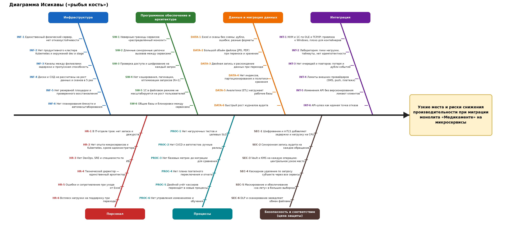

# Задание 4. Оценка узких мест при миграции — «Медикаменте»

Файлы: `ishikawa-migration.drawio` (исходник диаграммы для draw.io), `ishikawa-migration.png` (картинка) и этот отчёт.

## 1. Контекст миграции

Сейчас у компании нет единой системы. Данные лежат в Excel и сканах на общем диске, учёт ведётся в двух 1С в файловом режиме, ККМ связаны с сервером по TCP/IP и OLE. Всё работает на одном физическом сервере Windows Server 2022 в офисе, а IT-отдел состоит из трёх человек.

Цель миграции: перейти на единую платформу из сервисов (запись, пациенты, медданные, платежи, уведомления, интеграция с лабораторией) с личным кабинетом, мобильным приложением и аналитическим слоем (см. Task2). Платформа должна выдержать рост объёма данных и числа сотрудников в 5 раз и работать в нескольких филиалах. Стек IT-отдела: Java, Postgres, ClickHouse, Elastic, Kubernetes, VictoriaMetrics.

### Что затрагивает миграция

| Компонент или процесс | Что меняется | Где риск для производительности |
|-----------------------|--------------|----------------------------------|
| Данные пациентов, журналы врачей, реестр анализов (Excel, сканы) | Переезд в базы и объектное хранилище | Качество данных, объём файлов, расхождения при переходе |
| «1С:Бухгалтерия», «1С:Торговля и склад» | Остаются, но интегрируются с новой платформой | Файловый режим, OLE, привязка к Windows |
| Единственный сервер | Кластер Kubernetes и резервная площадка | Ёмкость, отказоустойчивость, переходный период |
| Запись на приём, регистрация, оплата, анализы | Новые сервисы вместо ручных операций | Границы сервисов, связность, латентность |
| Каналы связи (офис ↔ филиалы, ККМ, лаборатория, SMS-провайдер) | Новые внешние и внутренние интеграции | Задержки, лимиты, пики нагрузки |
| Защита данных (IAM, шифрование, аудит, согласия) | Новые обязательные шаги в каждом запросе | «Цена защиты»: шифрование, проверки доступа, аудит |
| Люди и процессы | Новые роли, CI/CD, дежурства | Нехватка опыта и людей, переходный период |

## 2. Диаграмма Исикавы

В «голове» диаграммы стоит проблема: **узкие места и риски снижения производительности при миграции**. Семь категорий причин: инфраструктура, ПО и архитектура, данные и миграция данных, интеграция, персонал, процессы, безопасность и соответствие. У каждой причины есть код (INF-1, SW-3 и т. д.), на него ссылаются таблицы ниже.

Категорию «Безопасность и соответствие» мы выделили отдельно намеренно. Приоритет компании — конфиденциальность, но шифрование, проверка доступа и аудит на каждый запрос сами становятся источником задержек, если их неправильно спроектировать.

## 3. Выявленные проблемы по категориям

В колонке «Как проявится» описано, что увидят пользователи или команда. В колонке «Чем измерять» указана метрика, по которой узкое место можно поймать заранее.

### 3.1. Инфраструктура

| Код | Проблема | Как проявится | Чем измерять |
|-----|----------|---------------|--------------|
| INF-1 | Единственный физический сервер | Любой сбой останавливает все процессы; при росте в 5 раз сервер упрётся в процессор и диск | Загрузка CPU и диска, доступность |
| INF-2 | Нет продуктивного кластера и окружений | Релизы проверяют сразу на «боевой» системе; ошибки конфигурации дают простои | Число инцидентов после релизов |
| INF-3 | Каналы между филиалами | Долгая загрузка карт и сканов в филиалах, обрывы при шифровании в VPN | Задержка и потери пакетов между площадками |
| INF-4 | Диски и СХД не рассчитаны на рост | Медленное открытие сканов, долгие резервные копии | IOPS, задержка чтения, время бэкапа |
| INF-5 | Нет резервной площадки | Потеря данных и долгое восстановление при аварии | RPO и RTO, результат тестового восстановления |
| INF-6 | Нет планирования ёмкости | Узкое место обнаруживается уже в пике нагрузки | Прогноз роста против текущей ёмкости |

### 3.2. Программное обеспечение и архитектура

| Код | Проблема | Как проявится | Чем измерять |
|-----|----------|---------------|--------------|
| SW-1 | Неверные границы сервисов («распределённый монолит») | Одно действие требует изменений и вызовов в нескольких сервисах, сервисы нельзя масштабировать по отдельности | Число сервисов, затронутых одним запросом |
| SW-2 | Длинные синхронные цепочки вызовов | Задержки складываются, отказ одного сервиса роняет цепочку | p95 задержки, трассировка запросов |
| SW-3 | Проверка доступа и шифрование на каждый запрос | Рост времени ответа на 20–50 мс и более на каждый шаг цепочки (оценка требует замера) | Задержка проверки ABAC и расшифровки |
| SW-4 | Нет кэширования, пагинации, оптимизации запросов | Медленные списки врачей, записей и пациентов | Время запроса, число запросов на страницу |
| SW-5 | 1С в файловом режиме | Блокировки и тормоза при росте числа пользователей | Время проведения документа, блокировки |
| SW-6 | Общие базы и блокировки между сервисами | Взаимные блокировки, сложность независимого развития | Блокировки БД, число таблиц с общим доступом |

### 3.3. Данные и миграция данных

| Код | Проблема | Как проявится | Чем измерять |
|-----|----------|---------------|--------------|
| DATA-1 | Excel и сканы без схемы | Дубли пациентов, ошибки в ФИО и датах, сорванные загрузки | Доля записей, не прошедших проверку |
| DATA-2 | Большой объём файлов | Перенос занимает дни, хранилище быстро заполняется | Объём данных, скорость переноса |
| DATA-3 | Двойная запись в переходный период | Расхождение между старой и новой системами, ручная сверка | Число расхождений при сверке |
| DATA-4 | Нет индексов и партиционирования | Замедление запросов по мере роста таблиц | План выполнения запросов, размер таблиц |
| DATA-5 | Аналитика нагружает рабочие базы | Тормоза записи на приём в моменты построения отчётов | Нагрузка на БД в часы отчётов |
| DATA-6 | Быстрый рост журналов аудита | Раздувание индексов и дисков, медленный поиск расследований | Объём журналов в сутки |

### 3.4. Интеграция

| Код | Проблема | Как проявится | Чем измерять |
|-----|----------|---------------|--------------|
| INT-1 | ККМ и 1С через OLE и TCP/IP | OLE работает только в Windows и плохо вписывается в контейнеры; потеря чеков при сбое связи | Число ошибок обмена, время передачи чека |
| INT-2 | Интеграция с лабораторией | Пиковые загрузки результатов, таймауты, повторные отправки создают дубли | Время ответа API, число дублей |
| INT-3 | Нет очередей и повторов | Потеря событий (напоминания, оплаты), дубли | Глубина очереди, число потерянных событий |
| INT-4 | Лимиты внешних провайдеров | Напоминания приходят с задержкой при массовой рассылке | Доля неотправленных уведомлений |
| INT-5 | Изменения API без версионирования | Мобильное приложение и партнёры ломаются после релиза | Число обращений к устаревшим версиям |
| INT-6 | API-шлюз как единая точка отказа | Отказ шлюза останавливает всю платформу | Доступность шлюза |

### 3.5. Персонал

| Код | Проблема | Как проявится | Чем измерять |
|-----|----------|---------------|--------------|
| HR-1 | В IT-отделе трое | Нет дежурств и замены, миграция идёт параллельно с поддержкой текущих систем | Время реакции на инциденты, загрузка |
| HR-2 | Нет опыта микросервисов и Kubernetes, кроме администратора | Ошибки в конфигурации и эксплуатации, долгий поиск причин сбоев | Число инцидентов по вине конфигурации |
| HR-3 | Нет DevOps, SRE и специалиста по ИБ | Автоматизация и безопасность делаются «по остаточному принципу» | Доля автоматизированных релизов |
| HR-4 | Технический директор — единственный архитектор | Решения упираются в одного человека, при его отсутствии работа встаёт | Число решений без документации |
| HR-5 | Сопротивление при уходе от Excel | Параллельная работа в двух системах, ошибки ввода | Доля записей, созданных в новой системе |
| HR-6 | Всплеск нагрузки на поддержку | Долгие ответы пользователям, срыв обучения | Число обращений в поддержку |

### 3.6. Процессы

| Код | Проблема | Как проявится | Чем измерять |
|-----|----------|---------------|--------------|
| PROC-1 | Нет нагрузочных тестов и целевых показателей | Узкие места выясняются у пользователей | Наличие SLO и результатов тестов |
| PROC-2 | Нет CI/CD и автотестов | Редкие и рискованные ручные релизы | Частота и длительность релизов |
| PROC-3 | Нет базовых метрик до миграции | Невозможно доказать, что стало лучше или хуже | Наличие замеров «до» |
| PROC-4 | Нет плана переключения и отката | Сбой при переключении означает простой всей клиники | Время отката |
| PROC-5 | Двойной учёт кассиров | Дублирующиеся ручные шаги перенесутся в новую систему | Доля ручных операций |
| PROC-6 | Нет управления изменениями и обучения | Сотрудники не знают новых процессов, растёт число ошибок | Охват обучением |

### 3.7. Безопасность и соответствие (цена защиты)

| Код | Проблема | Как проявится | Чем измерять |
|-----|----------|---------------|--------------|
| SEC-1 | Шифрование и mTLS | Рост задержек и нагрузки на процессор, особенно при множестве коротких соединений | Задержка и CPU с шифрованием и без |
| SEC-2 | Синхронная запись аудита | Каждое обращение ждёт записи в журнал; при сбое SIEM встают сервисы | Задержка записи, глубина очереди аудита |
| SEC-3 | Vault и KMS на каждую операцию | Центральный сервис ключей становится узким местом и точкой отказа | Число запросов к KMS, задержка |
| SEC-4 | Каскадное удаление по запросу субъекта | Тяжёлая операция по всем сервисам и копиям, возможна блокировка баз | Время выполнения запроса на удаление |
| SEC-5 | Маскирование и обезличивание «на лету» | Медленные отчёты и выгрузки | Время построения отчёта |
| SEC-6 | DLP и сканирование файлов | Замедление загрузки документов | Время обработки файла |

## 4. Оценка категорий

Оценка вероятности и влияния — экспертная, её стоит уточнить после нагрузочных тестов.

| Категория | Вероятность проблемы | Влияние на работу клиники | Итог |
|-----------|---------------------|---------------------------|------|
| Инфраструктура | Высокая | Высокое (остановка всех процессов) | Критичный риск |
| Программное обеспечение и архитектура | Высокая | Высокое | Критичный риск |
| Данные и миграция данных | Высокая | Высокое (ошибки в медданных) | Критичный риск |
| Интеграция | Средняя | Среднее и высокое (платежи, анализы) | Высокий риск |
| Персонал | Высокая | Высокое (срывает все остальные меры) | Критичный риск |
| Процессы | Средняя | Среднее | Высокий риск |
| Безопасность и соответствие | Средняя | Среднее (задержки), высокое при отказе KMS или аудита | Высокий риск |

## 5. Рекомендации и приоритеты

Шкала приоритетов:
- **P0** — сделать до начала миграции, иначе миграция небезопасна или неизмерима;
- **P1** — сделать в ходе MVP и до открытия филиалов;
- **P2** — сделать при развитии платформы до финального состояния (через год).

Усилия: **S** — до 2 недель, **M** — до 2 месяцев, **L** — больше.

| № | Мера | Закрывает | Приоритет | Усилия |
|---|------|-----------|-----------|--------|
| R1 | Снять базовые метрики «до»: время записи, открытия карты, число операций в день, объём данных и сканов | PROC-3 | P0 | S |
| R2 | Определить целевые показатели (SLO) и провести оценку ёмкости на рост в 5 раз; нагрузочное тестирование каждого сервиса до выхода в продуктив | PROC-1, INF-4, INF-6, SW-4 | P0 | M |
| R3 | Переходить поэтапно по принципу «душим монолит»: сначала запись на приём (MVP), затем остальные процессы; переключатели функций (feature flags), готовый план отката | SW-1, PROC-4, DATA-3 | P0 | M |
| R4 | Проектировать границы сервисов по доменам данных (запись, ПДн, медданные, платежи); у каждого сервиса своя БД, без общих таблиц | SW-1, SW-6 | P0 | M |
| R5 | Набрать или привлечь DevOps или SRE и специалиста по ИБ до старта; обучить команду Kubernetes и микросервисам; вести решения в виде ADR, чтобы архитектор не был единой точкой знаний | HR-1, HR-2, HR-3, HR-4 | P0 | M |
| R6 | Подготовить данные: профилирование и очистка Excel, единый реестр пациентов с дедупликацией, проверка форматов; сканы в объектное хранилище; перенос партиями со сверкой контрольных сумм | DATA-1, DATA-2, DATA-3 | P0 | L |
| R7 | Построить отказоустойчивую инфраструктуру: кластер Kubernetes минимум из трёх узлов, окружения dev, stage, prod, инфраструктура как код, резервная площадка и ежемесячная проверка восстановления | INF-1, INF-2, INF-5 | P0 | L |
| R8 | Асинхронные взаимодействия: события через брокер, паттерн outbox, ключи идемпотентности, повторы с задержкой, таймауты и «предохранитель» (circuit breaker) на внешних вызовах | SW-2, INT-2, INT-3, INT-4 | P1 | M |
| R9 | Снизить цену защиты: кэшировать решения OPA и проверку токенов, хранить ключи данных в кэше сервиса (конвертное шифрование), переиспользовать mTLS-соединения, писать аудит асинхронно через Kafka; замерить накладные расходы до и после | SW-3, SEC-1, SEC-2, SEC-3 | P1 | M |
| R10 | Отделить аналитику от рабочих баз: реплика или потоковая выгрузка в озеро, ETL в окна низкой нагрузки; индексы, партиционирование журналов, политика хранения | DATA-4, DATA-5, DATA-6 | P1 | M |
| R11 | Шлюз сделать отказоустойчивым (минимум два экземпляра), ввести версии API и контрактные тесты с лабораторией и мобильным приложением | INT-5, INT-6 | P1 | M |
| R12 | Интеграцию с ККМ и 1С вынести в отдельный адаптерный сервис с очередью; 1С перевести с файлового на клиент-серверный режим; на время MVP не менять контур 1С | INT-1, SW-5 | P1 | M |
| R13 | Настроить CI/CD с автотестами, дашборды и оповещения по SLO в VictoriaMetrics, процесс управления изменениями | PROC-2, PROC-6 | P1 | M |
| R14 | Пилотный запуск на одном отделе или филиале, обучение и шпаргалки, ограниченный по времени период параллельной работы, горячая линия поддержки | HR-5, HR-6, PROC-5 | P1 | S |
| R15 | Каналы между филиалами с резервом, мониторинг задержек, ограничение размера передаваемых сканов и предпросмотр вместо полной загрузки | INF-3 | P1 | M |
| R16 | Удаление по запросу субъекта через оркестрацию с идентификатором пациента: асинхронно, с отчётом; для документов удалять ключ пациента (crypto-shredding) | SEC-4 | P2 | M |
| R17 | Обезличивание считать заранее в ETL, а не «на лету»; файлы на DLP и сканирование отправлять в отдельную очередь с ограничением размера | SEC-5, SEC-6 | P2 | S |

### Порядок внедрения

1. **До старта (P0):** метрики «до» (R1), SLO и ёмкость (R2), границы сервисов (R4), люди (R5), подготовка данных (R6), инфраструктура (R7), план поэтапного переключения (R3).
2. **MVP (P1):** запись на приём как первый «задушенный» процесс, асинхронные события (R8), оптимизация цены защиты (R9), CI/CD и мониторинг (R13), пилот (R14).
3. **До открытия филиалов (P1):** отделение аналитики (R10), отказоустойчивый шлюз (R11), адаптер 1С и ККМ (R12), каналы между филиалами (R15).
4. **Развитие (P2):** удаление по запросу (R16) и оптимизация обезличивания (R17).

## 6. Предлагаемые целевые показатели

Значения предварительные, их нужно согласовать с бизнесом и подтвердить нагрузочными тестами.

| Показатель | Цель |
|------------|------|
| Запись на приём через портал, 95-й процентиль времени ответа | не более 1 с |
| Открытие расписания врача и карточки пациента | не более 2 с |
| Доступность портала в рабочие часы | не менее 99,9 % |
| Допустимая потеря данных при аварии (RPO) | не более 15 минут |
| Время восстановления (RTO) для ключевых сервисов | не более 4 часов |
| Деградация времени ответа при росте нагрузки в 5 раза | не более 20 % |
| Время обработки запроса на удаление данных | в пределах срока, установленного 152-ФЗ |

## 7. Остаточные риски

- Оценки в разделах 3 и 4 экспертные: реальные узкие места покажут нагрузочные тесты и замеры «до» (R1, R2).
- Кадровый риск (R5) остаётся самым вероятным: если людей не удастся найти до старта, объём работ по R7 и R13 нужно сокращать или отдавать подрядчику.
- Выбор сертифицированных средств защиты (см. Task3) может изменить расчёт задержек: СКЗИ с ГОСТ-шифрованием работают иначе, чем стандартный TLS. Замеры нужно повторить после выбора продуктов.
